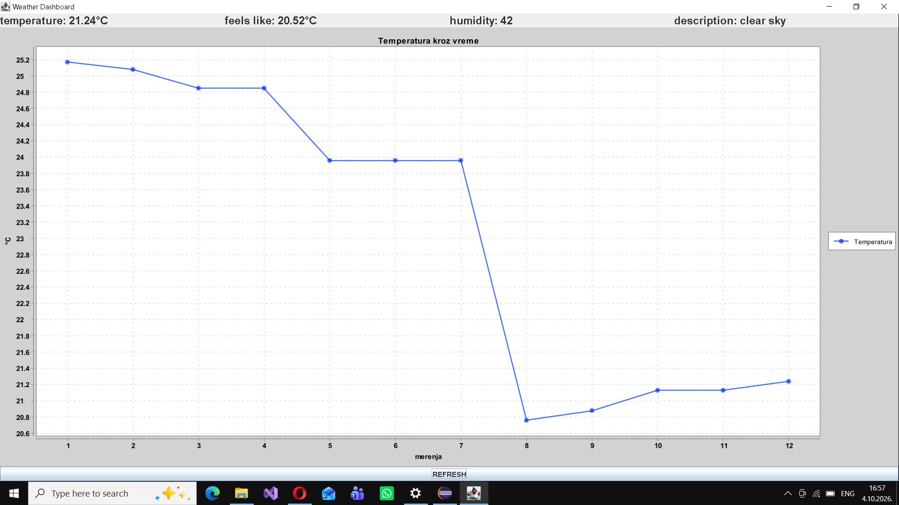

# Weather Dashboard
Java Swing aplikacija koja prikazuje trenutno vreme za izabrani grad i prati promene kroz vreme
## Funkcionalnosti
- Trenutni podaci sa OpenWeather API-ja (temperatura, osećaj, vlažnost, vetar)
- Svako merenje se automatski čuva u SQLite bazu
- Linijski grafikon promene temperature kroz vreme (XChart)
- Ručno osvežavanje dugmetom i automatsko osvežavanje na svakih 10 min

## Tehnologije
- Java 21 · Maven · Gson · SQLite (JDBC) · XChart · Swing

## Pokretanje
- Kloniraj repo i otvori projekat u Eclipse-u. Postavi environment varijablu `OPENWEATHER_KEY` sa svojim besplatnim   API ključem sa openweathermap.org3. Pokreni `DashboardFrame.main`

## Arhitektura
- `ApiClient` — poziv OpenWeather API-ja i parsiranje JSON-a (Gson)
- `WeatherReading` — model jednog merenja
- `WeatherDatabase` — čuvanje i učitavanje merenja (SQLite)
- `WeatherService` — spaja API i bazu
- `DashboardFrame` — Swing GUI: kartice, grafikon, osvežavanje